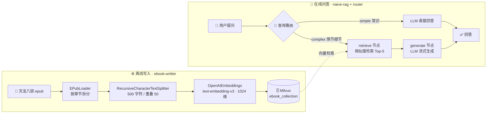
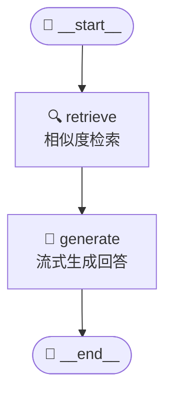
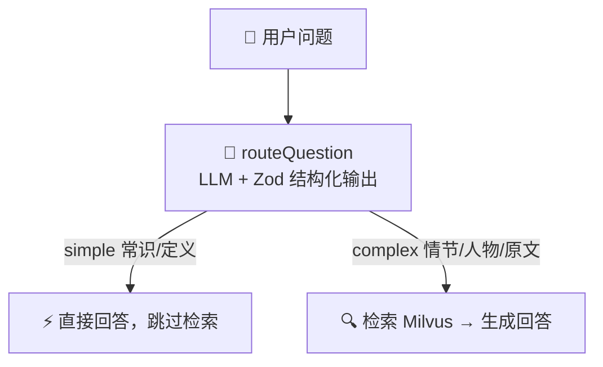

# 造一个"读过《天龙八部》"的 AI 助手 —— advance-rag 项目全解读

> 大模型没读过你的书？没关系——我们把整本《天龙八部》拆成碎片、变成向量存进 Milvus，再用 LangGraph 编排一条"先检索、后生成"的智能流水线。本文带你逐行拆解这个进阶 RAG 项目的三个核心脚本。

**技术栈**：LangChain.js · LangGraph · Milvus 向量库 · OpenAI 兼容接口 · Zod 结构化输出 · EPUB 电子书

---

## 📑 目录

1. [🎯 为什么需要 RAG？](#-一为什么需要-rag)
2. [🗺️ 整体架构：三步走](#-二整体架构三步走)
3. [🗂️ 第一步：知识库写入（ebook-writter.mjs）](#-三第一步知识库写入ebook-writtermjs)
4. [🔍 第二步：基础 RAG 检索问答（naive-rag.mjs）](#-四第二步基础-rag-检索问答naive-ragmjs)
5. [🧭 第三步：智能查询路由（rag-query-router.mjs）](#-五第三步智能查询路由rag-query-routermjs)
6. [💡 关键设计要点速查](#-六关键设计要点速查)
7. [🚀 动手跑起来](#-七动手跑起来)
8. [🌱 结语与改进方向](#-八结语与改进方向)

---

## 🎯 一、为什么需要 RAG？

直接问大模型"阿朱的结局是什么？"，它多半也能答个八九不离十——但你敢信吗？模型可能把电视剧和原著记混，甚至一本正经地编造情节。这就是典型的**幻觉（Hallucination）**问题。

RAG（Retrieval-Augmented Generation，检索增强生成）的思路非常朴素：**先查资料，再答题**。把私有知识（这里是一整本《天龙八部》电子书）切成小块、转成向量存进专门的向量数据库；用户提问时，先检索出最相关的几个片段，连同问题一起交给大模型，让它**基于证据回答**，而不是凭记忆发挥。

> 📌 **本项目要解决的问题**：以《天龙八部.epub》为唯一知识源，构建一个能准确回答小说情节、人物关系、原文细节的问答助手，并在此基础上演示"进阶"技巧——查询路由。

项目由三个脚本组成，恰好对应 RAG 系统的三个演进阶段：

| 脚本 | 角色 | 一句话职责 |
|------|------|-----------|
| `ebook-writter.mjs` | 🧱 索引工程师（离线） | 解析 EPUB → 分块 → 向量化 → 写入 Milvus |
| `naive-rag.mjs` | 🔍 问答引擎（在线） | LangGraph 状态图编排：检索 Top-5 片段 → 流式生成回答 |
| `rag-query-router.mjs` | 🧭 智能调度（进阶） | 让 LLM 判断问题类型，决定要不要走检索 |

## 🗺️ 二、整体架构：三步走

整个系统分**离线**和**在线**两条链路。离线链路负责"把书读懂存起来"，在线链路负责"接得住用户的提问"。先看全景图：



**图 1：advance-rag 全景架构——左边离线建库，在线链路按需检索**

理解这张图只需要抓住一句话：**写入端决定检索的下限，编排层决定体验的上限**。下面我们按数据流的顺序，从写入端开始拆。

## 🗂️ 三、第一步：知识库写入（ebook-writter.mjs）

这是整个系统的地基，做的事可以概括为一条流水线：**加载 → 分块 → 向量化 → 入库**。

### 3.1 📕 加载 EPUB：按章节切第一刀

项目用 LangChain 社区的 `EPubLoader` 直接解析电子书，并开启 `splitChapters`——第一刀由"章节"来切，天然保留了小说的结构信息：

```js
const loader = new EPubLoader(EPUB_FILE, {
  splitChapters: true, // 按章节拆分，每章一个 Document
});
const documents = await loader.load();
// ✓ 加载完成，共 N 个章节
```

### 3.2 ✂️ 二次分块：500 字符 + 50 重叠

一章几千字，直接整章向量化太"钝"——语义被稀释，检索也定位不准。所以要用 `RecursiveCharacterTextSplitter` 做第二刀。两个关键参数：

- **chunkSize = 500**：每块 500 个字符，粒度足够细，能精准定位到具体情节；
- **chunkOverlap = 50**：相邻两块重叠 50 字符，防止一句话被硬生生切成两半，导致两边都"说不完整"。

```text
片段 1  [==========================================]  第 0 – 500 字符
片段 2    [==========================================]  第 450 – 950 字符
片段 3      [==========================================]  第 900 – 1400 字符
          └── 重叠 50 ──┘
```

> 🔀 重叠区让被切断的句子在前后两个片段中都完整出现，检索时不会"断章取义"。

```js
const textSplitter = new RecursiveCharacterTextSplitter({
  chunkSize: CHUNK_SIZE,   // 500 字符
  chunkOverlap: 50,        // 重叠 50，保持上下文连贯
  // 未指定 separators，默认 ["\n\n", "\n", " ", ""]
  // —— 递归地优先按段落、再按行、再按词切，尽量不切断语义
});
```

### 3.3 🗄️ 设计 Milvus 集合：字段即"书签"

向量不是孤立存在的，每一块文本都挂上了完整的"出处坐标"——书 ID、章节号、块序号。这些元数据后面在生成回答时会直接展示给用户（"片段来自第 X 章"），是**可追溯性**的关键：

| 字段 | 类型 | 作用 |
|------|------|------|
| `id` | VarChar(100)，主键 | 手工构造：`bookId_章节号_块序号`，天然唯一、可重跑 |
| `book_id` / `book_name` | VarChar | 支持多本书共存一个集合 |
| `chapter_num` / `index` | Int32 | 章节与块位置，回答时可引用"第 X 章" |
| `content` | VarChar(10000) | 原文片段，生成时作为上下文 |
| `vector` | FloatVector(1024) | 片段的向量表示，检索的依据 |

主键 ID 的构造很有代表性——不依赖数据库自增，而是用业务坐标手工拼出来：

```js
const insertData = await Promise.all(
  chunks.map(async (chunk, chunkIndex) => {
    const vector = await getEmbedding(chunk); // 1024 维向量
    return {
      id: `${bookId}_${chapterNum}_${chunkIndex}`, // 手动 ID：可重跑、不重复
      book_id: bookId, book_name: BOOK_NAME,
      chapter_num: chapterNum, index: chunkIndex,
      content: chunk, vector,
    };
  })
);
await client.insert({ collection_name: COLLECTION_NAME, data: insertData });
```

### 3.4 ⚡ 边处理边插入的流式写入

整本书一次性加载、一次性向量化，内存和失败重来的代价都很大。这个脚本选择了更工程化的做法：**逐章处理，处理完一章立即入库**。中断了？已经写入的章节不用重来；内存？始终只保留一章的片段。

> 🧠 **为什么向量索引用 IVF_FLAT？** 写入端建索引时选择了 `IVF_FLAT`（nlist=1024）——先用聚类把向量空间分成 1024 个"桶"，检索时只在最相关的少数桶里精细比对。它是**建库速度、内存、召回的经典平衡点**，对一次性导入全量书籍的场景非常合适。

## 🔍 四、第二步：基础 RAG 检索问答（naive-rag.mjs）

书已入库，接下来是在线问答。这个脚本的核心不是"调两次 API"，而是用 **LangGraph** 把问答过程建模成一张**状态图（State Graph）**——这正是通往 Agentic RAG 的门票。

### 4.1 🧩 用状态图建模问答流程

LangGraph 的世界观：程序 = **状态 + 节点 + 边**。状态（State）是在节点间流转的共享数据；节点是干活的函数；边定义流转顺序。先声明状态，四个字段简单明了：

```js
const GraphState = Annotation.Root({
  question:   Annotation, // 问题
  k:          Annotation, // 检索数量
  document:   Annotation, // 检索到的文档
  generation: Annotation, // 生成的回复
})
```

然后把两个节点串成一条最简流水线 `retrieve → generate`：

```js
const graph = new StateGraph(GraphState)
  .addNode("retrieve", retrieveNode)
  .addNode("generate", generateNode)
  .addEdge(START, "retrieve")
  .addEdge("retrieve", "generate")
  .addEdge("generate", END)
  .compile(); // 编译后才能 invoke
```

这段代码的产出就是项目根目录 `a.md` 里那张图（脚本启动时会自动打印 mermaid 定义）：



**图 2：naive-rag 的 LangGraph 状态图（复现自 a.md）——最经典的线性 RAG 链路**

### 4.2 📡 retrieve 节点：带着分数的检索

检索用的是 `similaritySearchWithScore`——不只拿回片段，还带上**相似度分数**，方便后续判断"这些片段到底够不够像"：

```js
const docsWithScores = await vectorStore.similaritySearchWithScore(question, k);
return docsWithScores.map(([doc, score]) => ({
  document: doc.pageContent,
  score,                                // 相似度分数
  book_id:  doc.metadata?.book_id,      // 出处坐标一路带在身上
  chapter_num: doc.metadata?.chapter_num,
  ...
}))
```

注意向量库的连接方式是 `Milvus.fromExistingCollection`——**不建新集合，直接挂上写入端已建好的 ebook_collection**。这正是两个脚本之间的契约。

### 4.3 💬 generate 节点：有纪律的提示词 + 流式输出

检索到的片段先组装成带编号、带章节出处的上下文，再配合一套"回答纪律"送进模型：

```js
const prompt = `
你是一个专业的《天龙八部》小说助手。基于小说内容回答问题，用准确，详细的语言。
请根据以下《天龙八部》小说片段内容回答问题：
${context}
用户问题：${state.question}

回答要求：
1. 如果片段中有相关信息，请结合小说内容给出详细、准确的回答
2. 可以综合多个片段的内容，提供完整的答案
3. 如果片段中没有相关信息，请如实告知用户    // ← 抑制幻觉的关键一条
4. 回答要准确，符合小说的情节和人物设定
5. 可以引用原文内容来支持你的回答`;
```

生成过程采用**流式输出**（`model.stream`），边收边打印，体验接近打字机效果：

```js
const stream = await model.stream(prompt);
for await (const chunk of stream) {
  const text = typeof chunk === "string" ? chunk : chunk.content;
  if (!text) continue;
  generation += text;
  process.stdout.write(text); // 逐字上屏
}
```

> ⚖️ **一个值得注意的细节：两端索引配置不同。** 写入端真正建索引时用的是 `IVF_FLAT`；而查询端在 `fromExistingCollection` 里声明了 `HNSW`（M=16, efConstruction=200）并指定 `ef=64`。**实际生效的索引以 Milvus 集合中已创建的为准，查询端声明主要影响的是检索参数**。IVF_FLAT 与 HNSW 的取舍见下表：

| 维度 | IVF_FLAT（写入端配置） | HNSW（查询端声明） |
|------|------------------------|--------------------|
| 原理 | 聚类分桶，只搜最相关的几个桶 | 多层邻接图，贪心逐层导航 |
| 优势 | 建索引快、内存省、可控扫描范围 | 召回率更高、延迟更稳定 |
| 代价 | 召回受 nlist / nprobe 影响 | 建索引慢、内存占用更高 |
| 调参 | `nlist` / `nprobe` | `M` / `efConstruction` / `ef` |
| 适合 | 批量导入、资源敏感 | 高召回在线检索 |

## 🧭 五、第三步：智能查询路由（rag-query-router.mjs）

朴素 RAG 有个浪费：不管用户问什么，一律检索一遍。可"乔峰是谁？"这种常识问题根本不需要翻书。进阶的第一步，是给流水线装上**大脑——一个决定"走哪条路"的路由节点**。

### 5.1 🎯 用 Zod 给 LLM 的判断"上锁"

让 LLM 输出结构化结果，靠的是 `withStructuredOutput` + Zod schema。模型被约束成只能在 `simple / complex` 里二选一，并且必须给出理由：

```js
const RouteSchema = z.object({
  strategy: z.enum(["simple", "complex"]), // 枚举，只能二选一
  reason: z.string(),                      // 决策理由，可解释
});

const router = model.withStructuredOutput(RouteSchema);
const route = await router.invoke(`
  你是一个问答路由器，请判断用户问题是否需要外部检索。
  规则：
  - simple  : 常识问答、简短定义、无需特定小说细节即可回答
  - complex : 需要《天龙八部》具体情节、人物关系、章节事实、原文细节或证据支持
  用户问题：${state.question}`);
```

相比让模型输出 JSON 再手工 `JSON.parse`，`withStructuredOutput` 的价值在于：**Schema 校验失败会自动重试修正**，拿到手的一定是合法对象。

### 5.2 🔀 路由之后的两条路



**图 3：查询路由的决策逻辑——简单问题省一次检索，复杂问题保证有据可查**

当前仓库里，路由脚本是一个**独立的验证程序**：它单独跑一次决策并打印 `{ strategy, reason }`，帮你确认路由提示词的准确率。它的下一步归宿，是长进状态图里，变成一条**条件边（Conditional Edge）**：

```js
// 展望：把路由接入 LangGraph —— retrieve 不再是必经之路
const graph = new StateGraph(GraphState)
  .addNode("route", routeQuestionNode)
  .addNode("retrieve", retrieveNode)
  .addNode("generate", generateNode)
  .addEdge(START, "route")
  .addConditionalEdges("route", (s) =>
    s.strategy === "simple" ? "generate" : "retrieve") // 按状态分流
  .addEdge("retrieve", "generate")
  .addEdge("generate", END);
```

> 🚩 **从这里开始，就是 Agentic RAG 的世界。** 一旦图里有了条件边，你就可以继续加节点：查询改写（Query Rewriting）、多路召回、结果重排（Rerank）、自我反思（拿到低分片段就换个问法再查一次）……每一步都只是图上的一个新节点。

## 💡 六、关键设计要点速查

| 设计点 | 代码位置 | 为什么这么做 |
|--------|----------|--------------|
| chunkOverlap = 50 | `ebook-writter.mjs` | 跨块边界的信息两边都能看到，避免"断章" |
| 手工主键 `book_chapter_index` | `ebook-writter.mjs` | 幂等可重跑，重复导入不产生脏数据 |
| IVF_FLAT 建索引 | `ebook-writter.mjs` | 全量导入场景下建库快、内存省 |
| similaritySearchWithScore | `naive-rag.mjs` | 带分数返回，为"结果不够好就重试"留了钩子 |
| temperature = 0 | `naive-rag.mjs` | 问答要的是事实复述，不是创意发挥 |
| withStructuredOutput | `rag-query-router.mjs` | 枚举约束 + 自动重试，杜绝"自由发挥的 JSON" |

六句话总结：

- ✂️ **分块带重叠**——500 字符切块 + 50 重叠，句子不被腰斩，语义不被稀释；
- 🏷️ **元数据贯穿始终**——book_id / chapter_num 从写入带到检索结果，回答可引用出处；
- 🔄 **流式处理与输出**——写入端逐章入库，生成端逐字上屏，省内存、体验好；
- 🗺️ **状态图编排**——LangGraph 把流程变成可扩展的图，为 Agentic 演进铺路；
- 🔐 **结构化输出**——Zod Schema + withStructuredOutput，路由决策合法且可解释；
- 🛡️ **提示词抑制幻觉**——"没有相关信息请如实告知"，让模型学会说"书里没写"。

## 🚀 七、动手跑起来

复现这个项目需要三样东西：**本地 Milvus、环境变量、Node.js 环境**。

### ① 准备 Milvus（Docker 本地单机版，端口 19530）

```bash
docker run -d --name milvus -p 19530:19530 -p 19091:19091 milvusdb/milvus:latest
```

### ② 配置 `.env`（项目使用 OpenAI 兼容接口，可指向任意兼容网关）

| 变量 | 说明 |
|------|------|
| `OPENAI_API_KEY` | API 密钥 |
| `OPENAI_BASE_URL` | OpenAI 兼容接口地址 |
| `OPENAI_MODEL_NAME` | 对话模型名 |
| `EMBEDDINGS_MODEL_NAME` | 嵌入模型名（如 text-embedding-v3） |

### ③ 按顺序执行三个脚本

```bash
pnpm install

# 1️⃣ 建库：解析《天龙八部.epub》并写入 Milvus（耗时最长）
node src/ebook-writter.mjs

# 2️⃣ 问答：问它"阿朱的结局是什么？"，观察检索片段与流式回答
node src/naive-rag.mjs

# 3️⃣ 路由：验证路由器对不同问题的 simple / complex 判断
node src/rag-query-router.mjs
```

> 🧪 **试玩建议**：把 `naive-rag.mjs` 里的问题换成"段誉的六脉神剑是怎么学会的？"、"萧峰和乔峰是什么关系？"；再拿"1 + 等于几？"去测试路由器——你会看到它正确地给出 `simple`。

## 🌱 八、结语与改进方向

回头看，这个项目麻雀虽小、五脏俱全：它完整走过了 RAG 的经典链路——**索引（Indexing）→ 检索（Retrieval）→ 生成（Generation）**，并在最后递出了通向 Agentic RAG 的第一张名片：查询路由。三个脚本各自独立、职责单一，读起来就是三堂循序渐进的实验课。

如果继续往下打磨，这里有几个自然的演进方向：

- 🚚 **路由入图**：按第 5 节的 Conditional Edge 方案，把路由器长进状态图，形成真正的分支流程；
- 🔁 **查询改写**：检索前先让 LLM 把口语化问题改写成"检索友好"的关键词或多个子问题；
- 🏆 **结果重排（Rerank）**：粗召回 Top-20，再用重排模型精选 Top-5，精度再上一个台阶；
- 🪞 **自我反思**：检索分数太低或回答与原文矛盾时，自动换一种问法重查；
- 📊 **评估体系**：准备一批标准问答对，给每次改动一个客观的分数。

RAG 的世界并不神秘——把书撕成碎片、给碎片编上坐标、用相似度找回来、再让模型照着证据说话。**每一步，你都在替模型的"记忆"修一条更可靠的路。**

---

## 📚 延伸阅读

- [LangChain.js 官方文档](https://js.langchain.com/) —— 本项目使用的 EPubLoader、文本分割器与 Milvus 集成
- [LangGraph 官方文档](https://langchain-ai.github.io/langgraphjs/) —— StateGraph、Annotation 与条件边的完整用法
- [Milvus 官方文档](https://milvus.io/docs) —— 向量索引类型（IVF_FLAT / HNSW）与检索参数调优
- [Zod 官方文档](https://zod.dev) —— Schema 定义与结构化输出校验
