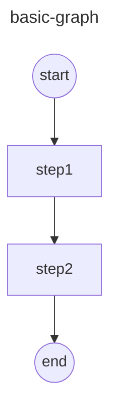
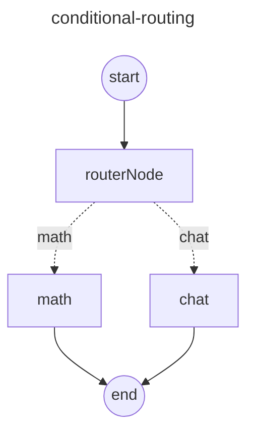
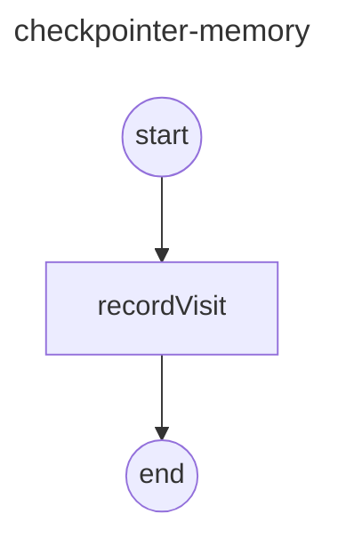
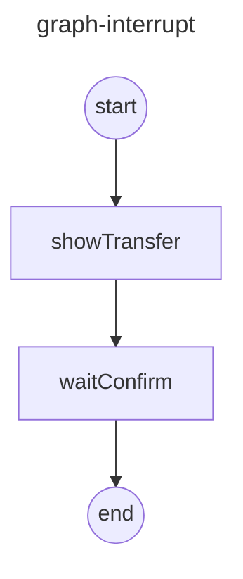
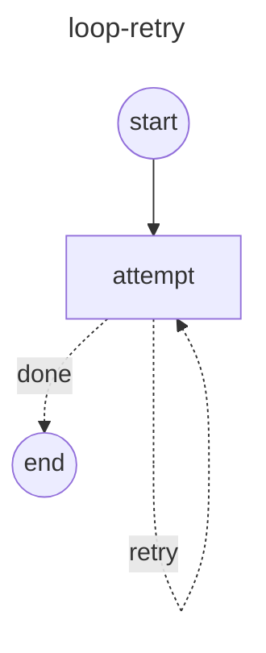

# 🚀 LangGraph 从入门到实战：构建有状态的 AI Agent 工作流

> 📌 **摘要**：本文基于实际代码示例，系统讲解 LangGraph 的核心概念与五大经典模式——线性流水线、条件路由、状态持久化、人机交互中断和重试循环，帮助你快速掌握图驱动的 AI Agent 编排技术。

---

## 📖 目录

1. [为什么需要多 Agent 架构？](#1-为什么需要多-agent-架构)
2. [LangGraph 是什么？](#2-langgraph-是什么)
3. [环境搭建](#3-环境搭建)
4. [核心概念速览](#4-核心概念速览)
5. [实战一：线性流水线](#5-实战一线性流水线-basic-graph)
6. [实战二：条件路由](#6-实战二条件路由-conditional-routing)
7. [实战三：状态持久化](#7-实战三状态持久化-checkpointer)
8. [实战四：人机交互中断](#8-实战四人机交互中断-interrupt)
9. [实战五：重试循环](#9-实战五重试循环-loop-retry)
10. [总结与展望](#10-总结与展望)

---

## 1. 🤔 为什么需要多 Agent 架构？

在构建复杂的 AI Agent 产品时，单 Agent 架构会遇到以下瓶颈：

| 问题 | 说明 |
|------|------|
| 🪙 **Token 浪费** | 所有工具描述和提示词都塞进一个 System Prompt，消耗大量 Token |
| 🎯 **决策准确率低** | LLM 面对过多工具选择时容易"迷路"，调用错误工具 |
| 🔗 **难以并行** | 单线程执行，无法同时处理多个子任务 |

**多 Agent 架构**的核心思想是**分而治之**：

```
Agent = LLM（大脑）+ Harness（工具 + MCP + RAG + Skills ...）
```

每个 Agent 只负责自己擅长的领域，携带精简的提示词，从而实现：

- ✅ **更高的决策准确率**——工具少，选择更精准
- ✅ **更低的 Token 消耗**——每个 Agent 只加载需要的上下文
- ✅ **并行处理能力**——多个 Agent 可同时工作

---

## 2. 🧩 LangGraph 是什么？

**LangGraph** 是 LangChain 生态中的图编排框架，它将 AI 工作流从线性链升级为**有向图**。

| 对比项 | LangChain | LangGraph |
|--------|-----------|-----------|
| 编排方式 | 线性链（Chain） | 图网络（Graph） |
| 核心 API | `chain.pipe()` | `addNode()` + `addEdge()` |
| 适用场景 | 简单的顺序流程 | 条件分支、循环、中断等复杂流程 |
| 状态管理 | 有限 | 内置持久化（Checkpointer） |

> 💡 **一句话理解**：LangChain 是"流水线"，LangGraph 是"交通网络"。

---

## 3. ⚙️ 环境搭建

### 项目结构

```
langgraph-test/
├── package.json
├── pnpm-lock.yaml
└── src/
    ├── basic-graph.mjs          # 线性流水线
    ├── conditional-routing.mjs   # 条件路由
    ├── checkpointer-memory.mjs   # 状态持久化
    ├── graph-interrupt.mjs       # 人机交互中断
    ├── loop-retry.mjs            # 重试循环
    └── test.mjs                  # eval 演示
```

### 安装依赖

```bash
# 使用 pnpm 安装依赖
pnpm add @langchain/langgraph @langchain/core @langchain/openai dotenv
```

### `package.json` 配置

```json
{
  "name": "langgraph-test",
  "type": "commonjs",
  "dependencies": {
    "@langchain/core": "^1.2.11",
    "@langchain/langgraph": "^1.4.15",
    "@langchain/openai": "^1.5.13",
    "dotenv": "^18.0.0"
  }
}
```

> ⚠️ 注意：示例文件使用 `.mjs` 扩展名（ES Module），而 `package.json` 中 `type` 为 `commonjs`。`.mjs` 文件会强制以 ESM 模式解析，不受 `package.json` 影响。

---

## 4. 🧠 核心概念速览

在动手写代码之前，先理解 LangGraph 的四大核心 API：

### 4.1 `Annotation.Root()` — 状态定义

```javascript
import { Annotation } from "@langchain/langgraph";

const StateAnnotation = Annotation.Root({
  text: Annotation({
    reducer: (prev, next) => next,  // 新值替换旧值
    default: () => "",
  }),
});
```

- **`reducer`**：定义状态合并策略（替换、累加、追加等）
- **`default`**：字段的初始值

### 4.2 `StateGraph` — 图构建器

```javascript
const graph = new StateGraph(StateAnnotation)
  .addNode("step1", step1Fn)      // 添加节点
  .addNode("step2", step2Fn)
  .addEdge(START, "step1")         // 定义边
  .addEdge("step1", "step2")
  .addEdge("step2", END)
  .compile();                      // 编译为可执行图
```

### 4.3 `START` / `END` — 哨兵节点

- `START`：图的入口，必须连接到第一个工作节点
- `END`：图的出口，表示流程结束

### 4.4 `addConditionalEdges()` — 条件边

```javascript
.addConditionalEdges("router", conditionFn, {
  "math": "mathNode",
  "chat": "chatNode",
});
```

条件函数根据当前状态返回路由键，图根据键值选择下一个节点。

### 📊 核心概念关系图

```
┌─────────────────────────────────────────────┐
│              StateGraph                      │
│                                              │
│  Annotation.Root()  ← 定义状态结构            │
│        │                                     │
│        ▼                                     │
│  ┌──────────┐    ┌──────────┐    ┌────────┐  │
│  │  START   │───▶│  Node A  │───▶│  END   │  │
│  └──────────┘    └────┬─────┘    └────────┘  │
│                       │                      │
│                       ▼                      │
│                 ┌──────────┐                 │
│                 │  Node B  │                 │
│                 └──────────┘                 │
│                                              │
│  addEdge()         ← 定义确定性边             │
│  addConditionalEdges() ← 定义条件边           │
│  compile()         ← 编译为可执行应用          │
└─────────────────────────────────────────────┘
```

---

## 5. 🟢 实战一：线性流水线 (Basic Graph)

> 🎯 **目标**：理解 LangGraph 最基础的用法——线性数据处理流水线。

### 代码实现

```javascript
// src/basic-graph.mjs
import { StateGraph, Annotation, START, END } from "@langchain/langgraph";

// ① 定义状态
const StateAnnotation = Annotation.Root({
  text: Annotation({
    reducer: (prev, next) => next,
    default: () => "",
  }),
});

// ② 定义节点函数
async function step1(state) {
  return { text: state.text + "->step1" };
}

async function step2(state) {
  return { text: state.text + "->step2" };
}

// ③ 构建图
const graph = new StateGraph(StateAnnotation)
  .addNode("step1", step1)
  .addNode("step2", step2)
  .addEdge(START, "step1")
  .addEdge("step1", "step2")
  .addEdge("step2", END)
  .compile();

// ④ 生成流程图（Mermaid 格式）
const mermaid = (await graph.getGraphAsync()).drawMermaid();
console.log(mermaid);

// ⑤ 执行图
const result = await graph.invoke({ text: "hello" });
console.log(result);
// 输出: { text: "hello->step1->step2" }
```

### 流程图



### 🔑 关键点

- 每个节点函数接收**当前状态**，返回**状态更新**
- `reducer: (prev, next) => next` 表示新值直接覆盖旧值
- `.compile()` 将图定义固化为可执行对象
- `getGraphAsync().drawMermaid()` 自动生成 Mermaid 流程图，方便可视化

---

## 6. 🔀 实战二：条件路由 (Conditional Routing)

> 🎯 **目标**：实现一个路由器，根据输入内容自动分流到不同的处理节点。

### 代码实现

```javascript
// src/conditional-routing.mjs
import { StateGraph, Annotation, START, END } from "@langchain/langgraph";

// ① 定义状态
const StateAnnotation = Annotation.Root({
  query: Annotation({ reducer: (prev, next) => next, default: () => "" }),
  router: Annotation({ reducer: (prev, next) => next, default: () => "chat" }),
  answer: Annotation({ reducer: (prev, next) => next, default: () => "" }),
});

// ② 路由节点：判断输入是数学表达式还是普通聊天
async function routerNode(state) {
  const isMath = /[+\-*\/]/.test(state.query);
  return { router: isMath ? "math" : "chat" };
}

// ③ 数学计算节点
async function mathNode(state) {
  try {
    const result = eval(state.query);
    return { answer: `计算结果: ${result}` };
  } catch (e) {
    return { answer: `计算错误: ${e.message}` };
  }
}

// ④ 聊天回复节点
async function chatNode(state) {
  return { answer: `收到你的消息: ${state.query}` };
}

// ⑤ 构建图（带条件路由）
const graph = new StateGraph(StateAnnotation)
  .addNode("routerNode", routerNode)
  .addNode("math", mathNode)
  .addNode("chat", chatNode)
  .addEdge(START, "routerNode")
  .addConditionalEdges("routerNode", (state) => state.router, {
    math: "math",
    chat: "chat",
  })
  .addEdge("math", END)
  .addEdge("chat", END)
  .compile();

// ⑥ 测试
console.log(await graph.invoke({ query: "1+2*3" }));
// { query: "1+2*3", router: "math", answer: "计算结果: 7" }

console.log(await graph.invoke({ query: "你好" }));
// { query: "你好", router: "chat", answer: "收到你的消息: 你好" }
```

### 流程图



> 💡 虚线表示**条件边**，实线表示**确定性边**。

### 🔑 关键点

- `addConditionalEdges(源节点, 条件函数, 路由映射)` 是实现分支的核心
- 条件函数返回**路由键**，图根据映射表选择目标节点
- 这是经典的 **Router Pattern（路由器模式）**，广泛用于意图识别、任务分发等场景

---

## 7. 💾 实战三：状态持久化 (Checkpointer)

> 🎯 **目标**：使用 `MemorySaver` 实现多用户独立的会话状态追踪。

### 代码实现

```javascript
// src/checkpointer-memory.mjs
import { StateGraph, Annotation, START, END, MemorySaver } from "@langchain/langgraph";

// ① 定义状态
const StateAnnotation = Annotation.Root({
  visitCount: Annotation({ reducer: (prev, next) => next, default: () => 0 }),
  message: Annotation({ reducer: (prev, next) => next, default: () => "" }),
});

// ② 节点：记录访问次数
async function recordVisit(state) {
  const newCount = state.visitCount + 1;
  return {
    visitCount: newCount,
    message: `你好！你已访问 ${newCount} 次`,
  };
}

// ③ 创建 Checkpointer（内存存储）
const checkpointer = new MemorySaver();

// ④ 编译图，绑定 checkpointer
const graph = new StateGraph(StateAnnotation)
  .addNode("recordVisit", recordVisit)
  .addEdge(START, "recordVisit")
  .addEdge("recordVisit", END)
  .compile({ checkpointer });

// ⑤ 模拟多用户访问
const user1Config = { configurable: { thread_id: "用户-小张" } };
const user2Config = { configurable: { thread_id: "用户-小李" } };

console.log(await graph.invoke({}, user1Config));
// { visitCount: 1, message: "你好！你已访问 1 次" }

console.log(await graph.invoke({}, user1Config));
// { visitCount: 2, message: "你好！你已访问 2 次" }

console.log(await graph.invoke({}, user2Config));
// { visitCount: 1, message: "你好！你已访问 1 次" }  ← 独立计数！
```

### 流程图



### 🔑 关键点

- **`thread_id`** 是会话的唯一标识符，不同 `thread_id` 的状态完全隔离
- **`MemorySaver`** 将状态存储在内存中，适合开发和测试
- 生产环境可替换为 **SQLite**、**Redis** 等持久化存储
- `compile({ checkpointer })` 是启用状态持久化的关键配置

### 📌 状态存储对比

| 存储方式 | 适用场景 | 持久性 |
|----------|----------|--------|
| `MemorySaver` | 开发测试 | 进程内存，重启丢失 |
| `SqliteSaver` | 单机生产 | 磁盘持久化 |
| `RedisSaver` | 分布式生产 | 内存 + 持久化 |

---

## 8. ⏸️ 实战四：人机交互中断 (Interrupt)

> 🎯 **目标**：实现银行转账场景中的"人工确认"流程——暂停执行，等待用户输入。

### 代码实现

```javascript
// src/graph-interrupt.mjs
import {
  StateGraph, Annotation, START, END,
  MemorySaver, interrupt, Command
} from "@langchain/langgraph";
import readline from "readline";

// ① 定义状态
const StateAnnotation = Annotation.Root({
  actionSummary: Annotation({
    reducer: (prev, next) => next,
    default: () => "",
  }),
  userInput: Annotation({
    reducer: (prev, next) => next,
    default: () => "",
  }),
  result: Annotation({
    reducer: (prev, next) => next,
    default: () => "",
  }),
});

// ② 展示转账详情
async function showTransfer(state) {
  const summary = "转账 ¥5000 给 张三 (6222 **** 1234)";
  return { actionSummary: summary };
}

// ③ 等待确认（中断点）
async function waitConfirm(state) {
  // 🚨 interrupt() 会暂停图的执行，返回控制权给调用方
  const userInput = interrupt({
    hint: "请确认是否继续操作？(y/n)",
    actionSummary: state.actionSummary,
  });

  if (userInput === "y") {
    return { userInput, result: "✅ 转账成功！" };
  } else {
    return { userInput, result: "❌ 转账已取消" };
  }
}

// ④ 构建图
const checkpointer = new MemorySaver();
const graph = new StateGraph(StateAnnotation)
  .addNode("showTransfer", showTransfer)
  .addNode("waitConfirm", waitConfirm)
  .addEdge(START, "showTransfer")
  .addEdge("showTransfer", "waitConfirm")
  .addEdge("waitConfirm", END)
  .compile({ checkpointer });

// ⑤ 第一次调用 —— 会在 interrupt 处暂停
const config = { configurable: { thread_id: "bank-session-1" } };
const firstResult = await graph.invoke({}, config);
console.log("⏸️ 图已暂停，等待用户确认...");

// ⑥ 读取用户输入并恢复执行
const rl = readline.createInterface({ input: process.stdin, output: process.stdout });
rl.question("请确认 (y/n): ", async (answer) => {
  // 🚨 使用 Command({ resume }) 恢复执行
  const finalResult = await graph.invoke(new Command({ resume: answer }), config);
  console.log(finalResult.result);
  rl.close();
});
```

### 流程图



### 🔑 关键点

- **`interrupt()`** 是 LangGraph 的人机交互原语，暂停图执行并返回中断信息
- **`Command({ resume: value })`** 用于恢复被中断的图，将用户输入传回中断点
- **必须配合 Checkpointer** 使用——暂停/恢复依赖状态持久化
- 典型应用场景：审批流程、敏感操作确认、人工审核

### 📌 执行流程

```
调用方                    图执行器
  │                          │
  │── invoke() ─────────────▶│
  │                          │── showTransfer()
  │                          │── waitConfirm()
  │                          │    └── interrupt() ← 暂停！
  │◀── { __interrupt__ } ───│
  │                          │
  │── Command({ resume }) ──▶│
  │                          │    └── 继续执行
  │◀── { result } ──────────│
```

---

## 9. 🔄 实战五：重试循环 (Loop & Retry)

> 🎯 **目标**：实现一个自动重试机制，直到操作成功或达到最大次数。

### 代码实现

```javascript
// src/loop-retry.mjs
import { StateGraph, Annotation, START, END } from "@langchain/langgraph";

// ① 定义状态
const StateAnnotation = Annotation.Root({
  tries: Annotation({ reducer: (prev, next) => next, default: () => 0 }),
  ok: Annotation({ reducer: (prev, next) => next, default: () => false }),
  message: Annotation({ reducer: (prev, next) => next, default: () => "" }),
});

// ② 尝试节点
async function attempt(state) {
  const newTries = state.tries + 1;
  const success = newTries >= 3; // 第 3 次尝试成功
  return {
    tries: newTries,
    ok: success,
    message: success
      ? `✅ 第 ${newTries} 次尝试成功！`
      : `❌ 第 ${newTries} 次尝试失败，继续重试...`,
  };
}

// ③ 构建图（带自循环）
const graph = new StateGraph(StateAnnotation)
  .addNode("attempt", attempt)
  .addEdge(START, "attempt")
  .addConditionalEdges("attempt", (state) => (state.ok ? "done" : "retry"), {
    retry: "attempt",  // 失败 → 回到 attempt
    done: END,         // 成功 → 结束
  })
  .compile();

// ④ 执行
const result = await graph.invoke({});
console.log(result);
// { tries: 3, ok: true, message: "✅ 第 3 次尝试成功！" }
```

### 流程图



### 🔑 关键点

- **自循环**：节点可以通过条件边指向自身，形成循环
- 条件函数返回 `"retry"` 或 `"done"`，决定是继续循环还是退出
- 适用于：API 调用重试、轮询等待、质量检查等场景
- 实际使用中应设置**最大重试次数**，防止无限循环

---

## 10. 🎯 总结与展望

### 📊 五大模式速查表

| 模式 | 核心 API | 典型场景 | 文件 |
|------|----------|----------|------|
| 🟢 线性流水线 | `addEdge()` | 数据处理管道 | `basic-graph.mjs` |
| 🔀 条件路由 | `addConditionalEdges()` | 意图识别、任务分发 | `conditional-routing.mjs` |
| 💾 状态持久化 | `MemorySaver` + `thread_id` | 多用户会话管理 | `checkpointer-memory.mjs` |
| ⏸️ 人机交互 | `interrupt()` + `Command()` | 审批流程、敏感操作 | `graph-interrupt.mjs` |
| 🔄 重试循环 | `addConditionalEdges()` 自循环 | API 重试、轮询等待 | `loop-retry.mjs` |

### 🧠 LangGraph 的核心价值

```
传统线性链:    A → B → C → D

LangGraph 图:      ┌──→ B ──┐
               A ──┤        ├──→ D
                   └──→ C ──┘
                        ↑
                        └── (自循环重试)
```

LangGraph 将复杂的 AI Agent 工作流从**线性链条**升级为**有向图网络**，提供：

- 🔀 **灵活的分支与路由**——根据状态动态选择执行路径
- 💾 **内置的状态持久化**——支持多会话、断点续传
- ⏸️ **原生的人机交互**——`interrupt` / `resume` 机制
- 🔄 **原生的循环支持**——重试、轮询、迭代优化
- 📊 **可视化能力**——自动生成 Mermaid 流程图

### 🚀 下一步学习方向

1. **接入 LLM**：将节点函数替换为真实的 LLM 调用（`@langchain/openai`）
2. **子图嵌套**：在一个节点中嵌套另一个 `StateGraph`
3. **持久化存储**：从 `MemorySaver` 升级到 `SqliteSaver` 或 `RedisSaver`
4. **流式输出**：使用 `.stream()` 逐节点输出中间结果
5. **多 Agent 协作**：多个 LangGraph 图之间的通信与协调

---

> 📝 **作者注**：本文所有代码均基于 `@langchain/langgraph@^1.4.15`，可在 `langgraph-test/src/` 目录下找到完整示例。建议按 `basic-graph → conditional-routing → checkpointer-memory → graph-interrupt → loop-retry` 的顺序逐步学习。

---

*🎉 Happy Coding with LangGraph!*